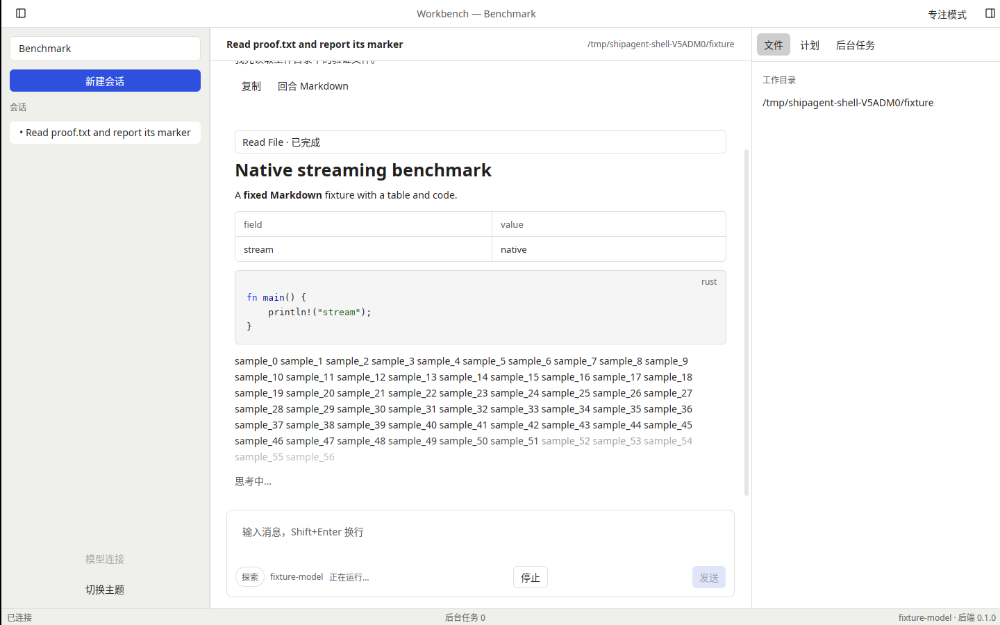
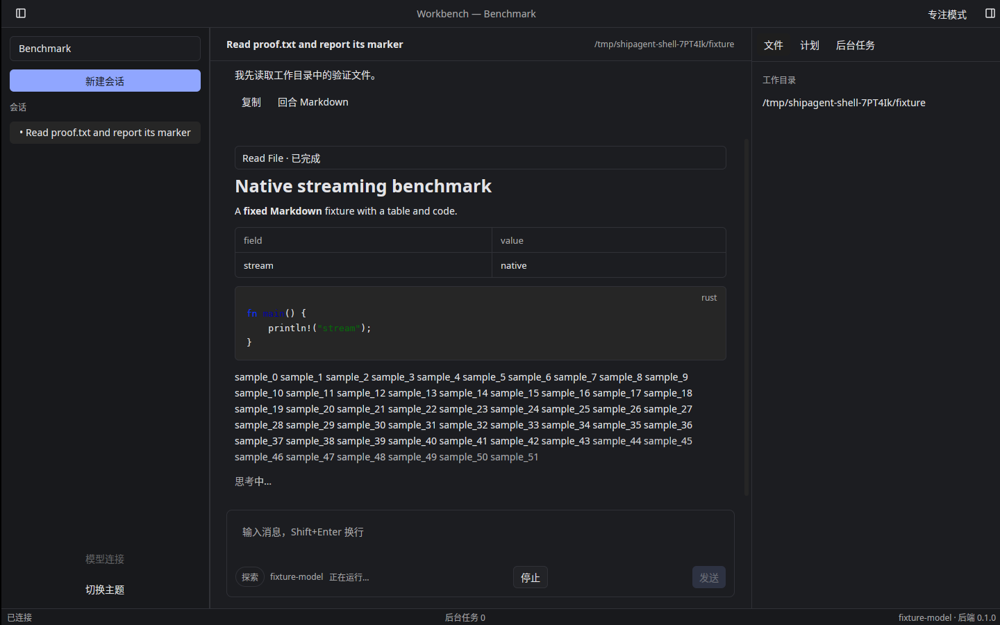

# T-1-12 原生对话视图验证（2026-11-03）

基线 main `7ccfa57`（PR #18 已合并），后端仍固定 mkagent v0.2.6。本轮实现 ChatView、TurnCard、MarkdownView 及 F-15/F-19 的原生呈现与操作；完整 ToolCard/Diff/Editor/嵌套归 T-1-13，附件预览、完整 Composer、计划接受与侧栏工作流继续按各自任务推进。

ChatView 独立订阅 SessionStore，行与 Turn 一一对应，使用 Kit MessageScroller 的 append/splice/定向 remeasure，保留跟随尾部、上滚锚点及“跳到最新”。Markdown 按消息 ID 缓存为 Entity，流式 push_str、最终内容 set_text 原位校正；未渲染的消息仍保留在规范会话模型中。视口附近前后200行的渲染缓存可淘汰，回滚时从最新规范内容重建；回合实体按稳定键复用，后缀变动更新索引并清除过期键，卡片弱引用缓存以免所有权环。

助手卡分活动区与答复区，严格使用 derive_turn_phase：pending/awaiting Shimmer、活动工具 Spinner 与真实可用耗时、streaming 文档淡入和光标、complete 复制/回合 Markdown。超过3条活动的完成回合默认收起，可用原生按钮展开；运行时活动始终可见。摘要显示工具和活动数量；有 elapsedSeconds 时明确标为“最长工具耗时”，不把并发或单个工具耗时冒充整个回合耗时。复制与详情排除已提升为最终答复的同源中间文本，避免重复。

用户消息使用 Kit Message/Bubble，右对齐、最大80%宽；pending半透明、queued虚线及标签，保留badge和附件文件名。复制、从此处分支走显式意图；分支通过受epoch保护的现有加载路径与typed facade，安全模式创建，不覆盖原草稿。系统状态使用居中Marker；typed_error显示标题、正文、可展开技术详情及声明的操作按钮。重试解析当前规范错误与最近用户消息，复用原始附件；begin_resend明确不拥有当前草稿，即使文本完全相同，成功/失败也不清空或恢复草稿。忙时不重复派发重试。

Markdown使用Kit可选中TextView，保留代码高亮和表格；链接意图由控制器处理，详情弹窗也保留链接订阅直到关闭。Web链接、工作目录相对文件与本机file链接通过应用策略路由，拒绝可执行scheme/远程file地址。UI不持RPC或凭据；错误操作按message ID/key从规范模型重新解析。

新增原生测试覆盖五阶段、活动折叠与答复保留、千行历史的缓存边界/滚动重建、typed_error按钮与技术详情、用户复制/分支意图、Markdown实体身份/最终校正/中文选中复制及真实链接点击、提升文本去重。原有流式混合批次、会话切换与滚动锚点测试继续通过。另有分支wire参数、真实后端分支，以及相同/空/不同草稿与附件在重试成功/失败下保留的回归。完整计数和最终三平台CI见PR及导出证据。

Linux X11/Xvfb/lavapipe亮暗实窗各完成真实Read、50模拟token/s的Markdown（表格/Rust代码）流式与最终出帧，二次启动聚焦、原生快捷键、偏好保存和正常退出零拥有子进程均通过。使用现有 [shell-smoke](../tools/shell-smoke/README.md)，截图内容为本地验证模型的明确基准夹具；未使用真实模型凭据。调试功能证据不等于参考机帧预算、1万消息800ms或物理桌面验收。

阶段0、参考机性能、物理桌面、真实签名/公证和发布门槛仍开放；PR #6 工程包保留。下一项 T-1-13：完整工具卡（摘要、Diff、只读Editor、大结果与嵌套）。
