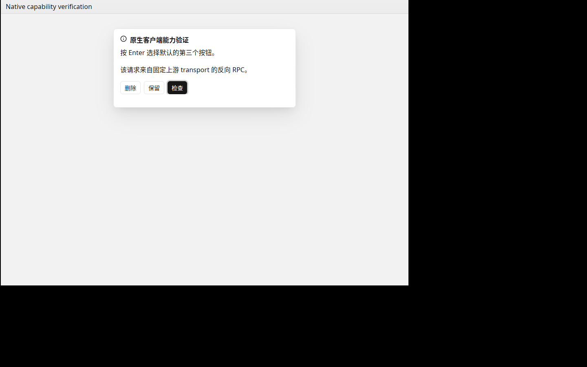
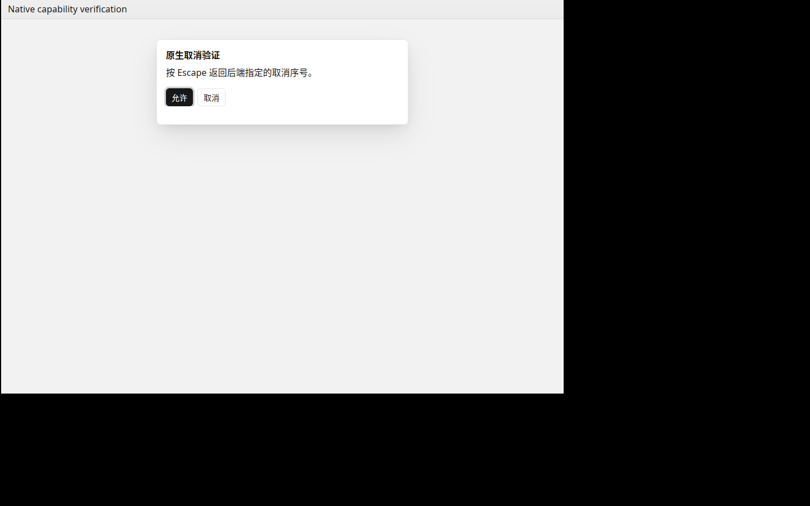

# T-1-19 原生客户端能力验证

基线为合并 PR #25 的 dc75e90，按 02 客户端能力表、03 client_caps 与 05 工程规范实现。固定后端 v0.2.6 未修改。下一项 T-1-20 原生菜单与快捷键。

## 实现

握手前注册 client:openExternal、client:openPath、client:showItemInFolder、client:confirmDialog、client:openFileDialog，初始和工作区连接均保留注册。未声明 client:browser:invoke。

URL 只允许 http/https/mailto；路径要求本地绝对路径。外部 URL 在 GPUI 前台分派，打开/定位路径使用后台 OS opener。参数错误和能力不可用返回协议错误，不吞掉失败。

确认框优先使用最近激活窗口的 Kit AlertDialog，按钮响应保持后端原始序号，支持 detail/type/defaultId/cancelId。Enter 选择焦点或默认项，Esc 返回取消项。无窗口时使用 rfd；rfd 不能表达的重复按钮、非首项默认或更多按钮，改用所属临时 Kit 窗口，关闭该临时窗口返回 cancelId。普通父窗口关闭返回错误。此适配保留协议语义，区别于简单截断按钮或忽略默认项。

文件选择支持文件/目录、多选、标题、默认路径与过滤器，取消返回 canceled=true/filePaths=[]。GPUI 基础选择器用于 Windows/Linux；带过滤器/默认路径时使用 rfd。macOS 生产环境统一使用显式父窗口的 rfd sheet，避免 GPUI 无父窗口面板；自动化 TestPlatform 单独使用可控 GPUI 路径响应。无法表达的混合文件/目录选择返回明确不可用错误。默认路径文件系统检查放在后台。

能力桥接有界，排队操作检查请求存活；连接断开/旧代际取消后丢弃迟到结果。确认与文件选择串行，确认框关闭后保留模态锁到 Kit 退出动画与焦点恢复结束，避免上一个延迟关闭误伤下一个请求。取消只关闭所属确认框，不关闭其他应用模态。

## 验证

Linux 默认核心 275 项、完整 app/UI/perf/samples/capabilities 135 项通过。最终能力单元及原生 UI 14 项、真实 transport 契约 1 项重跑通过；fmt、国际化检查、默认和全特性 clippy 通过。新增测试涵盖 URL/路径校验、默认/取消序号、多选/目录/取消、窗口关闭、重复按钮及代际清理。

真实契约启动固定上游 WsRpcServer，通过实际 WebSocket 反向调用生产能力桥接，验证确认、目录选择、URL 分派、路径错误、未声明浏览器能力和断线清理。该项使用 GPUI TestPlatform 的对话/路径模拟，不冒充系统文件面板实测；三平台 native-check 均显式执行该契约。最终三平台结果以本 PR 对应提交 CI 为准。

Linux Xvfb/Vulkan 原生窗口使用 tools/client-caps/smoke.mjs，隔离配置和随机 token，无外部模型/用户密钥；通过固定 transport 显示两个真实 Kit 确认框，xdotool 依次发送 Enter/Escape，实际返回 response=2、response=1。截图已人工核对。原生进程退出码 0，未强制清理，无所属子进程残留。

独立 Spec 与 Standards 审查无阻塞。原生 OS 文件面板交互、外部应用启动及物理桌面仍需人工验收；已显示的系统面板无法通过当前 API 强制关闭，断线后仅忽略迟到响应。阶段 0、参考机性能、实体桌面、Developer ID 签名/公证及发布门槛仍开放；按用户决定保留 PR #6 工程包。

