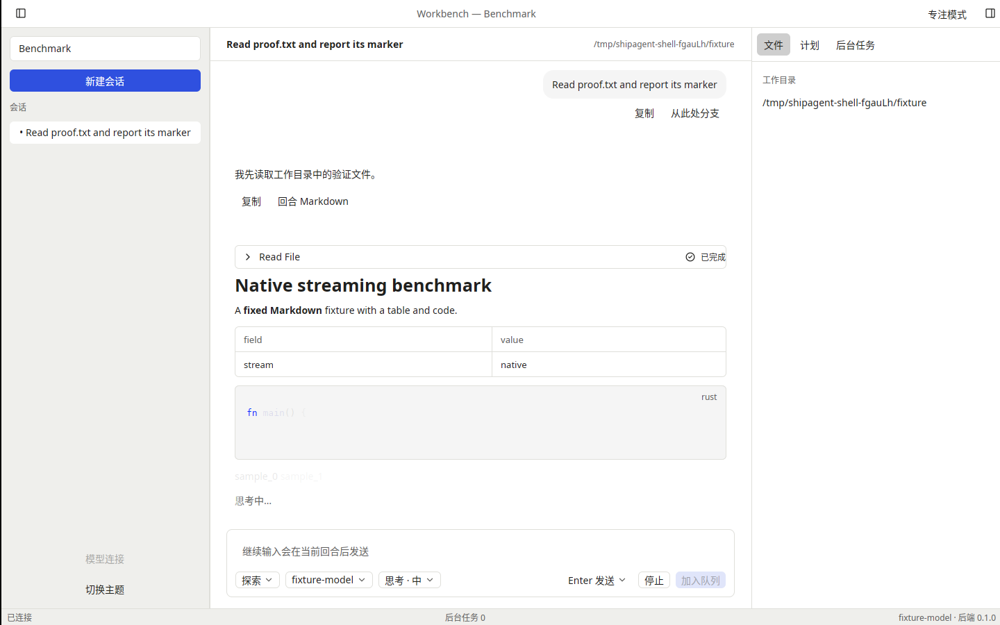
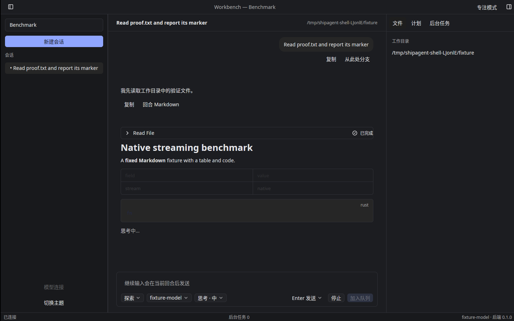

# T-1-14 Composer 验证（2026-11-04）

基线 main `f9d3779`（PR #20 已合并），后端仍固定 mkagent v0.2.6。本轮实现 F17/F18/F25/F29：独立原生 Composer、发送键/IME、取消、运行中排队，以及会话级权限模式、模型与思考等级。下一项 T-1-15 PermissionPrompt、执行模式警示和 Shift+Tab。

Composer 拥有 Kit Textarea Entity，1–12行自动增高，随后内部滚动。原生 Enter/Shift+Enter 与 Cmd/Ctrl+Enter 直接在输入动作捕获阶段处理，避免先插入换行再发送；组字时检查原生 marked range，不派发发送。空白内容不发送。空输入按↑仅召回本会话最近用户文本。发送键通过工具栏菜单选择并写客户端原子偏好，旧偏好文件默认 Enter；完整设置页归 T-2-02。

输入保持空闲、运行中排队、审批等待、断开、加载、无模型等状态提示。运行中可继续输入和发送，现有规范 SessionModel 负责 optimistic pending/queued 消息、接受确认和中断恢复；Composer 不复制消息队列。停止与 Esc 走真实取消 RPC；输入焦点处由原生 Escape 捕获，会话其他区域使用 StopProcessing，菜单、Dialog 与 Sheet 保留自身关闭行为。发送确认只清除仍归该次发送拥有的草稿，后续编辑保留。

模型菜单按已认证连接分组，去重连接内模型 ID，保留跨连接同名模型；来源为后端安全连接目录，兼容字符串和对象模型，不从客户端枚举凭据。当前选择按会话→工作区→连接默认解析，失效连接或不可用模型阻止发送，但仍可选择其他可用模型。选择同时提交模型与连接 ID，不修改工作区/全局默认。思考等级提供 off/low/medium/high/xhigh/max；权限模式走会话命令。三类操作由控制器执行，成功确认后更新规范会话字段，失败保留原值与草稿。

配置请求占用状态保存在每个打开的 SessionStore 原生 Entity，控制器串行化同一会话配置；A→B→A 切换保留占用，不会派发重叠请求。完成时核对启动 epoch 和缓存 Entity 身份。传输绑定前拒绝会释放本地临时锁，恢复后可继续使用。Composer 只在相关配置或状态改变时失效，不因每个答复 token 重新创建输入或无条件触发子视图通知。

本地完整默认核心274项、原生 app/UI/perf/samples 79项通过，其中新增8项原生 Composer 回归：多行/两种发送键、中文预编辑/提交、队列/审批输入、历史/断开、认证菜单与失效连接、三类工具栏意图及菜单Esc、缓存会话占用/传输拒绝恢复、工作区默认覆盖。另有 typed wire 参数回归和发送键原子偏好持久化断言。fmt、核心与完整原生 clippy（all-targets/all-features）、141键 i18n门禁通过。规格和工程规范独立审查均无剩余阻塞。

首次CI在Windows触发既有能力取消测试的时序竞态：重连通知不能保证被取消future已完成析构。本地最小Executor探针可确定复现此假设错误；测试改为有界等待旧handler的析构通知，并继续断言旧回复不能进入新socket，不改变生产传输行为。最终三平台结果以下述PR检查为准。

真实后端 Agent 契约已验证会话模型/连接、High思考及Ask权限保存，随后恢复Safe执行真实Read并完成答复；第二个流式回合取消后在2秒内收到 interrupted 并恢复非busy。三平台最终提交的自动化结果以PR检查及导出证据为准。

Linux X11/Xvfb/lavapipe 亮暗真实工作台截图与功能冒烟见下方。窗口使用明确的本地模型基准夹具，无真实模型凭据；测试验证真实Read、流式答复、二次启动聚焦、快捷键、偏好保存及正常退出。

完整审批与执行警示归 T-1-15；附件 T-2-06、@/Skill T-2-07、后端草稿保存恢复 T-2-08、上下文占用 T-2-12 继续按计划推进。本轮保留会话草稿，不宣称完成这些流程。阶段0、参考机性能、物理桌面/IME候选窗口、真实签名/公证及发布门槛仍开放，PR #6 工程包保留。
