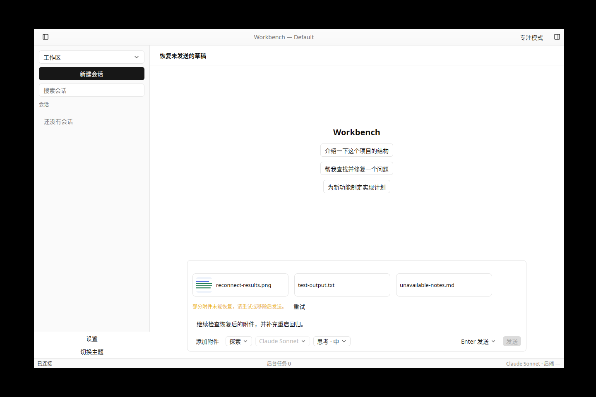
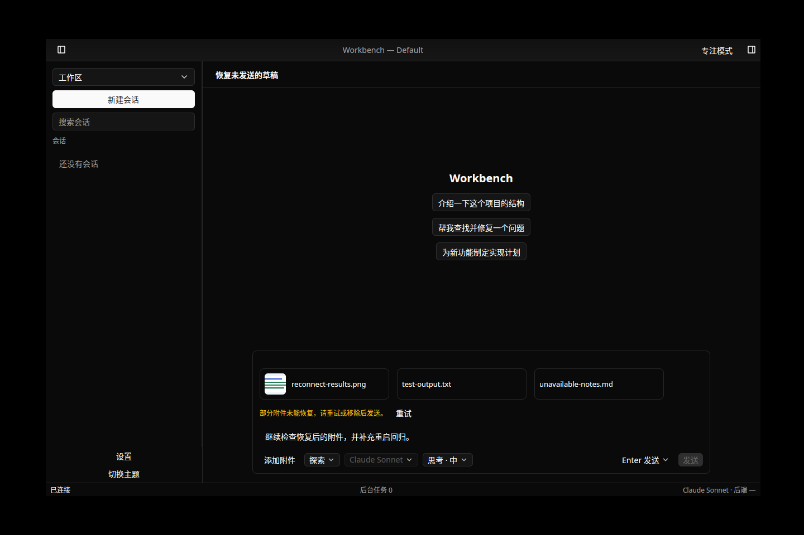

# T-2-08 草稿保存与恢复验证

基线为已合并 PR #38（`2b7c04e`）。实现依据 01·F-28、02·drafts 频道、04·输入区；固定后端与模型夹具未更改。

文本、附件增删触发 500 ms 防抖；单个后台写入器按会话合并快照并串行调用 drafts:set/delete。路径文件保存引用，剪贴板文件保存内容；大字节通过 Arc 共享，wire 克隆与文件恢复在后台执行。上游 20 MiB 内容限制、RPC 限制或磁盘失败显示错误并支持重试，失败项不被当作已保存。

打开会话恢复文本、路径文件与剪贴板预览；加载结果受连接、实体、请求及本地编辑版本保护。失效引用保留为可移除卡片，可恢复文件后重试；未恢复前阻止发送。项目 Skill 目录在还原原生 token 前加载。恢复数据不会自动写回覆盖远端。重连、实体重建和工作区切换保留本地草稿及失效引用。

普通消息、附件与计划发送只消费对应版本；ACK 后新增文本、附件保留，失败不复活用户已主动删除的内容。正常退出同步捕获原生输入并冻结编辑，等待已接收的附件导入，再强制刷写；5 秒失败后可返回重试或明确选择不保存退出。窗口级冻结跨异步会话绑定持续有效。系统退出回调仅有受限的尽力刷写，不保证断电或任意强杀耐久性。

## 本地证据

- 默认核心/RPC/工具测试 298 通过；原生 Composer 25 通过，包含冷恢复显示、失效引用、加载拖拽保护及退出后异步换会话冻结。
- 全部原生 UI 集成与 lib、应用 lib/perf、客户端能力测试通过；写入器回归覆盖 500 ms 合并、旧 SET/DELETE/新 SET 的 ACK 乱序、断线保留与失败重试。附件 IO 回归覆盖可读、缺失与损坏内容的部分恢复。
- `draft_contract_parent` 对真实固定后端运行两次独立客户端进程：恢复项目 Skill、路径及剪贴板附件，失效引用跨后端重启保留/重试，原生输入在防抖未到期时刷写，会话隔离，发送期间新增文本/文件保留，已消费内容删除；新客户端校验剪贴板 PNG 原始字节一致。
- 真实后端恢复、附件、提及、计划调度契约另作回归。三平台的 unit/native-check、后端契约和原生 E2E 由本轮 PR 检查记录；自动化不替代实体设备验收。
- `fmt`、全工作区所有 target/feature 的 clippy、i18n 及 codegen 防漂移检查通过。双轴审查的问题均已修复并补回归。

原生 Linux 实窗截图是显式渲染夹具，用于检查失效附件提示、恢复文本与预览，不作为真实后端链路证据：

## 保留的验收缺口

本轮发现固定工程后端上传 PNG 时返回 `sharp is not a function`。真实草稿契约验证图片保存/恢复/预览及冷启动字节后，在发送前移除图片；实际发送验证使用文本文件。该图片上传问题与既有 F-26 50 MB / 16 MiB 帧限制继续开放，不能据本轮结果宣称图片发送或完整附件容量通过。

阶段 0/P0、Windows 任意强退落盘、参考硬件性能、实体桌面/IME/辅助功能及正式 Developer ID/公证保持开放；正式签名依用户决定暂缓。下一项 T-2-09 视图筛选、搜索、置顶/归档/已读。
