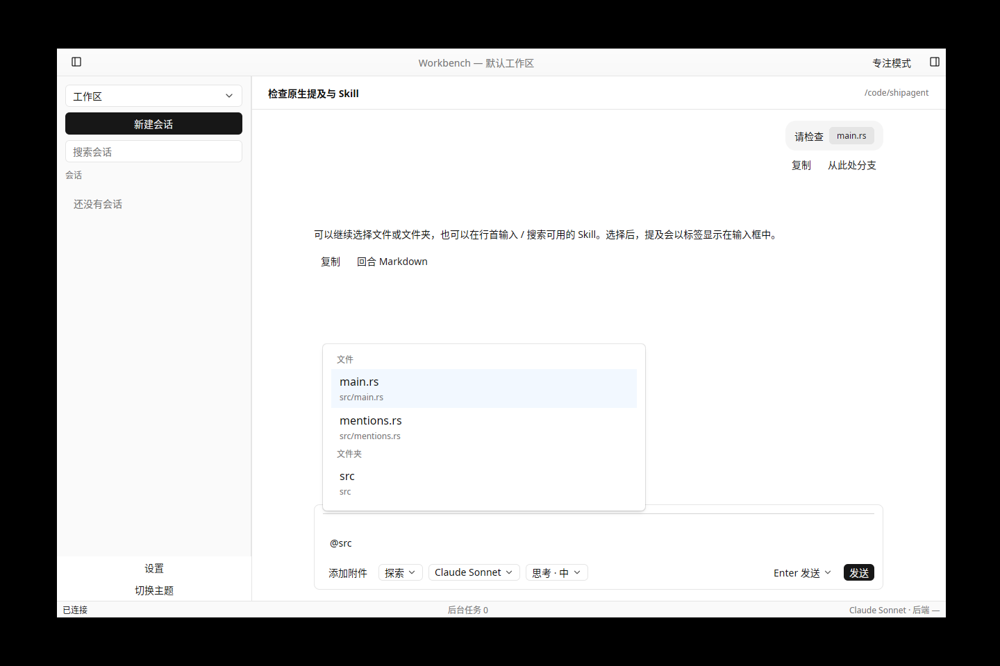
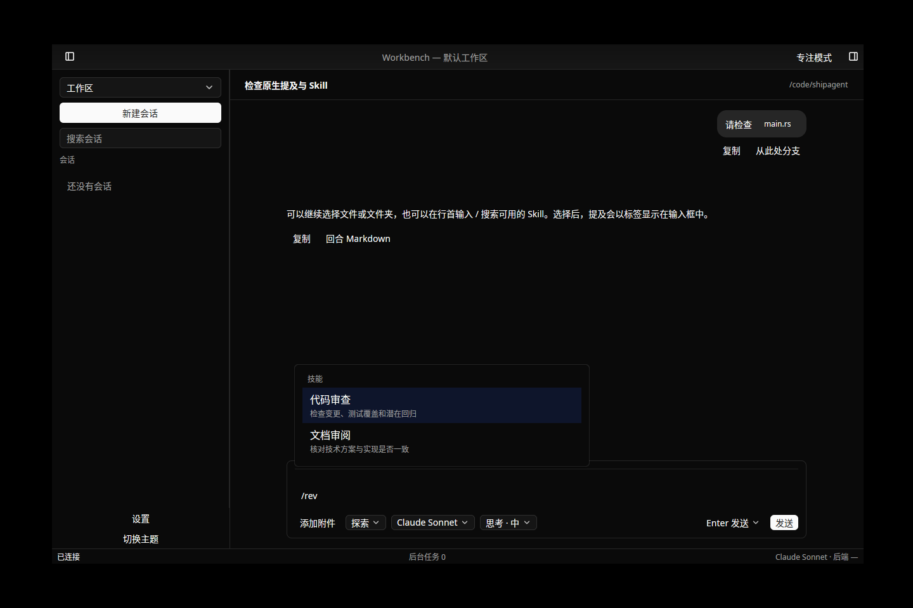

# T-2-07 提及与 Skill 验证

基线 PR #37 合并 `0b7a324`，上游仍固定 mkagent v0.2.6 `6e8ebc4`，没有修改上游或固定模型脚本。

实现范围：

- `core::mentions` 解析/生成文件、文件夹和 Skill bracket，按上游 ASCII Skill 语法、来源限定和去重规则工作。编辑器 UTF-8 范围与协议 UTF-16 位置分开处理。
- Kit Textarea 原子 token、Popover/List Entity 分组候选；@ 搜索 150 ms 防抖；行首 / 按名称、slug 和描述查 Skill，含 /compact。↑↓、Tab/Enter、Esc、鼠标选择及输入法保留；历史和会话恢复重建 token。
- UI 只发意图。控制器绑定实际连接及会话工作目录，检查会话 Entity、连接代际、目录和请求序号。项目 `.agents/skills` 按目录加载，`skills:changed` 失效缓存；菜单和发送共用目录过滤。
- 普通、附件和历史重发携带 badges/skillSlugs。乐观消息及用户消息显示 Tag，重发保留历史 badge。客户端发送 bracket；后端按既有逻辑解析文件路径和 Skill 读取指引。

本地验证：

- 默认工作区测试通过；原生回归分批通过，输入区 20 项覆盖弹层实际可见/鼠标焦点、中文与 IME、撤销/整体删除、/compact 二次 Enter、Esc 后字面发送、分组移动、旧结果、目录变更、失败重试与历史召回。
- `node tools/mentions/oracle.mjs --check` 执行固定上游共享解析和 renderer badge 提取，12 组包括 UTF-16、来源限定、未知 Skill、重复项、嵌套括号和非法字符；Rust 按生成证据对照。
- 精确 WebSocket 契约验证 fs:search 和两个发送入口的五位置参数；真实 bundled backend + 本地脚本模型验证文件/目录搜索、项目 Skill 可用范围、模型收到解析后的路径及 Skill 文件读取指引、两条发送路径的 badge 和重启恢复。
- fmt、Clippy（原生所有 targets）、i18n、codegen 检查；双轴审查修正命令重复触发、历史 token 恢复、可访问名称及旧目录项目缓存。
- CI 包含 Linux、macOS、Windows 的默认/原生测试、真实提及契约及既有原生 E2E；最终结果见该 PR Checks，不将本地 Linux 结果表述为跨平台人工验收。

截图是显式原生渲染夹具，不是在线模型实测证据：

草稿磁盘持久化归下一项 T-2-08。本轮不关闭 F-26 完整 50 MB 容量缺口、阶段 0/P0、参考硬件性能、实体桌面或正式 Developer ID/公证门槛；正式签名按用户决定继续暂缓。

Windows 冷启动契约边界：CI 初轮在提及恢复处失败，诊断轮又在既有附件恢复处失败，均发生在停后端后的 sessions:getMessages。源码确认 `runTurn` 先设 `isProcessing=false` 再 await `flushSession`，Windows 进程树终止会立即 kill。因此两个“已持久化重启”契约改用现有 typed `sessions:export` 的 flush 屏障，先断言磁盘导出包中的元数据，再保留原有冷读取断言；没有用 sleep 或读取重试掩盖问题。此项验证不证明任意强退无损，Windows 退出与写入交叠仍列入阶段 0/P0 生命周期验收。
