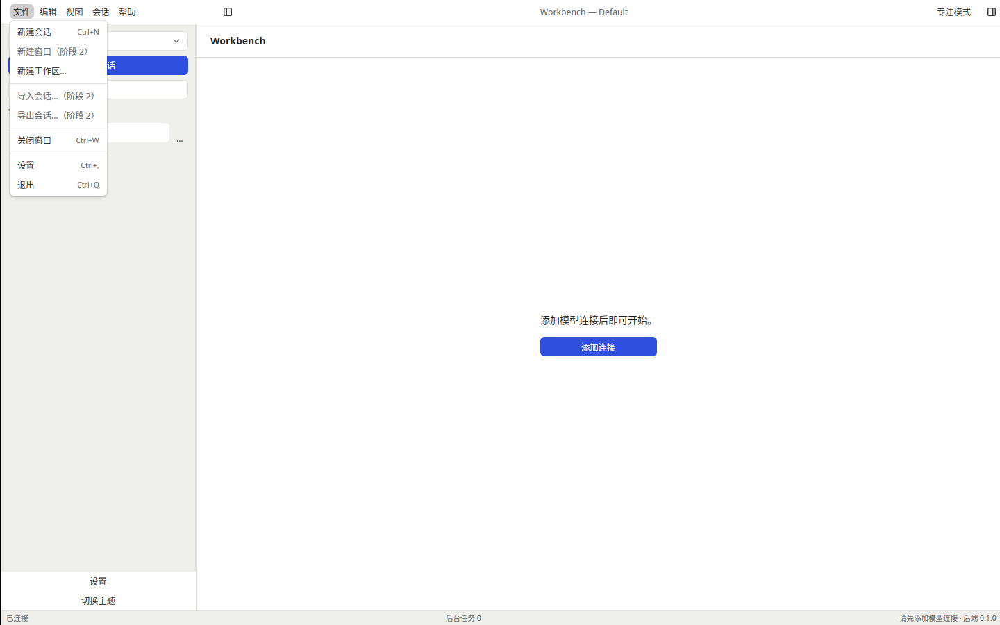
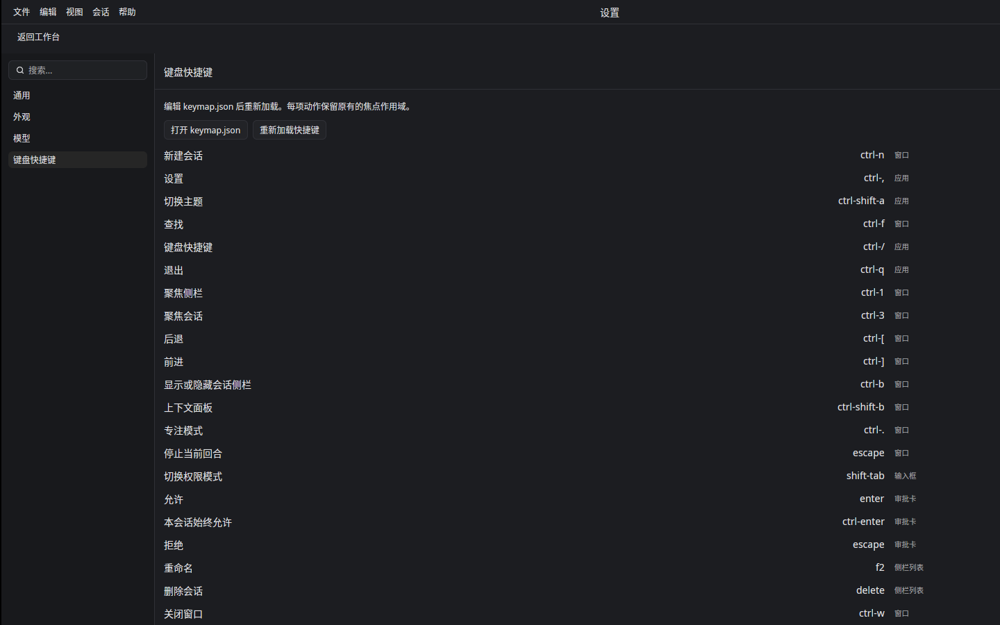
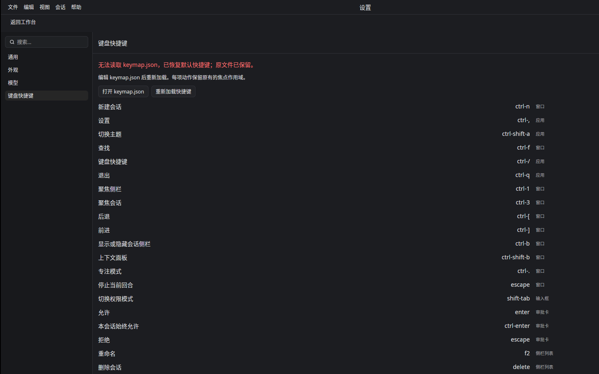

# T-1-20 原生菜单与快捷键验证

基线为合并 PR #26 的 4e45c46，依据 04 快捷键/菜单表、01 F-38、03 动作与配置设计。下一项 T-1-21 连接与异常态。

## 实现

macOS 使用 cx.set_menus；Windows/Linux 使用相同树的 Kit AppMenuBar。文件/编辑/视图/会话/帮助与 macOS 应用菜单共用集中 Action。编辑命令使用 Kit Input Action 与 OsAction 路由到当前焦点控件；语言、命令可用状态及 keymap revision 变化都会重建菜单，避免 macOS 保留旧 accelerator。

阶段1提供新建会话/工作区、设置、主题、侧栏搜索、区域焦点、会话历史、布局、缩放、当前会话重命名/删除、关于/NOTICE、关闭及退出。阶段2的新窗口/会话内查找、置顶/归档、分支/导入导出、日志诊断，以及阶段3更新仍按各自任务推进；相关菜单入口明确禁用。引导期间保留设置/快捷键入口禁用，防止绕过首启流程。

用户 keymap.json 支持按动作覆盖、移除及热重载，作用域固定。文件读取/创建和系统编辑器打开均在后台（首次读取在 GPUI 启动前）。校验动作/按键/重复/大小/版本；无效文件保留原文，恢复默认并显示提示。新建文件先写入临时文件并同步，再无覆盖提交；失败明确提示。重载代际阻止迟到读取覆盖最新请求。

审批键只在审批卡生效；移除 Delete 同时停用 Backspace 别名，移除 Esc 同步停用 Composer 旧取消处理。Shift+Tab 使用真实 Kit Input 上下文，移除后不再回落到旧 OutdentInline。输入组字与弹层沿用组件保护。

新建成功后聚焦输入框；无模型时聚焦可见会话区域。历史记录初始会话，只在成功打开后移动，失败不改变游标，新导航截断前进分支，跳过已删会话；工作区变化重置该窗口历史。

退出时直接读取规范会话实体，不依赖上一帧缓存。运行中需要确认；原生窗口关闭、Kit 标题栏关闭、关闭菜单与退出快捷键统一进入确认及后端监督器清理路径。

## 验证与边界

Linux 默认核心 275 项通过。完整原生 149 项与显式真实反向 RPC 契约 1 项通过，覆盖焦点空态、历史分叉、keymap 覆盖/移除/重载、审批作用域、Esc/Shift+Tab/Backspace、菜单 revision、实时退出确认和文件失败恢复。fmt、国际化 311 引用键、全特性 clippy 与普通 workbench 构建检查通过；最终三平台结果以本 PR 提交 CI 为准。

Linux Xvfb/Vulkan 普通应用实窗（非 perf 绕过）已检查文件菜单、侧栏收起/聚焦、新建/前进/后退、主题、快捷键设置、自定义键生效、旧默认键停用、坏文件恢复默认及旧自定义键停用。截图人工核对。原生退出码0、无强制清理、无所属子进程残留。独立 Spec/Standards 审查发现的问题已修复并补回归。

三平台自动化测试和 macOS/Windows 窗口提交不替代实体桌面菜单、系统编辑器和输入法矩阵的人工验收。阶段0、参考机性能、实体桌面、Developer ID 签名/公证和发布门槛保持开放；按用户决定保留 PR #6 工程包。

