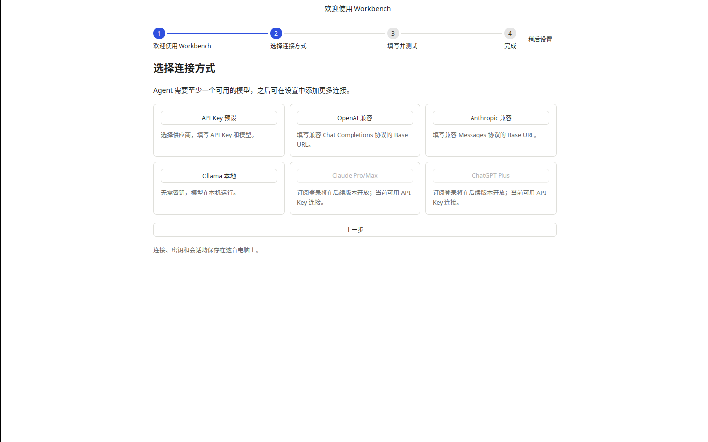
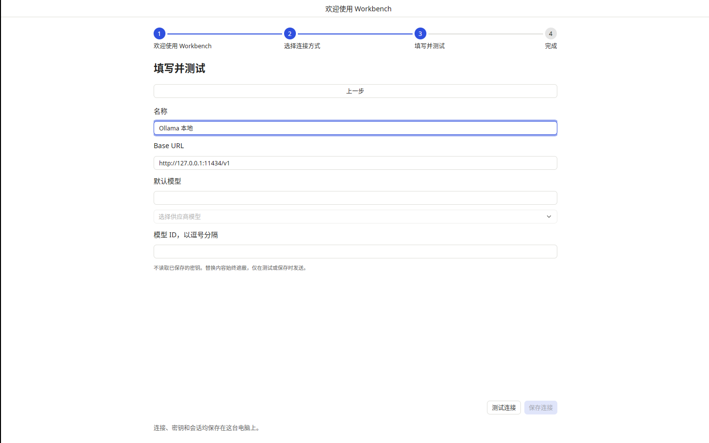
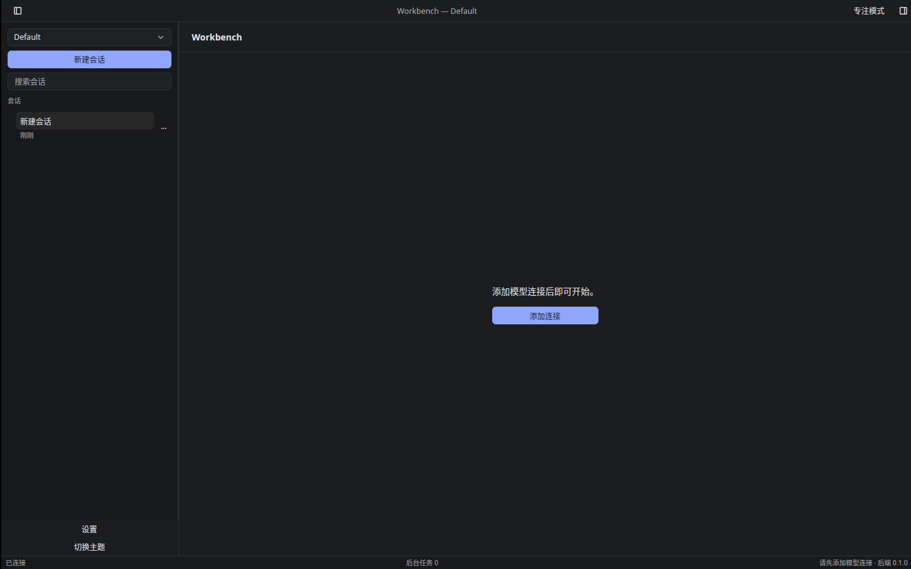

# T-1-18 首次启动引导验证

基线为合并 PR #24 的 f19ed5a，按 01 F-04/U1、03 OnboardingController、04 原型实现。下一项 T-1-19 客户端能力五项。

## 实现

- 全窗口 Kit Stepper 四步：欢迎、连接方式、填写并测试、完成。展示六个入口；API Key 预设、自定义 OpenAI/Anthropic 兼容端点、Ollama 本轮可用；Claude/ChatGPT 订阅登录明确提示后续开放，归 T-2-03/04。
- 复用安全 ConnectionEditor，密码字段不读取保存的密钥。成功测试后才启用保存，输入或供应商变化会使测试失效；控制器保存前再次实际探测，保存并设为默认后才进入完成页。返回和重启丢弃表单、清除未保存密钥。
- 非 OAuth slug 移植 mkagent v0.2.6 的 resolveSlugForMethod：pi-api-key、pi-api-key-2 等。重选方法时刷新目录；探测后、写入前检查同名连接身份。保存成功后的默认选择失败可按本次 slug/createdAt 重试；不会覆盖已观察到的其他连接。
- Finish 再读取服务端目录，确认本次保存的连接仍认证且默认。失效则回到方法页并显示错误；RPC 失败保留重试，避免完成按钮永久禁用。沿用启动时拥有的空会话，已有消息时另建会话，并恢复 Composer 焦点。
- 无认证连接且未延期时自动引导。跳过必须先获 onboarding:deferSetup 回执，再写本地镜像标记；上游 getAuthState 未暴露 setupDeferred，不能据此恢复延期。延期后工作台显示添加模型空态，不能发送；设置添加模型后正常恢复。
- 浏览器工具关闭只在本地 browser_initialized 为 false 时执行，成功启动后记录；旧偏好兼容默认值。重启不覆盖用户后续浏览器工具设置。

## 验证

Linux 默认核心 275 项、完整 app/UI/perf/samples 121 项通过，含输入变更后的测试失效、跳过重复提交、禁用 OAuth 入口、slug 冲突、连接身份/完成恢复策略与旧偏好兼容。fmt、256 引用翻译键门禁及默认/全特性 clippy 通过；最终三平台结果以本 PR 对应提交 CI 为准。

新增三平台真实后端契约 onboarding：全新配置、浏览器关闭、实际延期落盘、未保存模型探测不注册连接、保存/设默认/编辑、清除延期及重启后恢复认证默认连接。该测试与既有 settings、Agent、审批、导航、14 类录制回放一同执行。本地云环境的 SDK 模型探测受只读 homedir()/sessions 阻断，仍保留真实断言由三平台 CI 执行，没有修改 HOME 或伪造探测成功。

Linux 普通原生应用的亮暗窗口验证使用 tools/onboarding/smoke.mjs，全新隔离配置、不启用 perf 绕过，检查欢迎/方法/表单、返回清理、实际延期、模型空态及重启恢复；关闭后在本测试配置恢复 browserToolEnabled，再启动确认首次初始化不会重复覆盖。每次退出核对监督器进程树。脚本不访问用户配置或密钥。

## 限制

后端 setup/save/default 是多步操作，没有原子 create-only/CAS 接口；客户端写前检查不能消除最后一次检查与实际写入之间的多客户端竞态。setup 已提交而后续读取/元数据保存失败时，保留后端记录；返回方法页会刷新目录并分配新后缀，避免盲目覆盖，不能声称原子回滚。

最终独立 Spec 与 Standards 审查无阻塞。原生控件、CI 窗口提交与实体桌面验收分别记录。阶段 0、参考机性能、实体桌面、Developer ID 签名/公证和发布门槛仍开放；按用户决定保留 PR #6 工程包。

