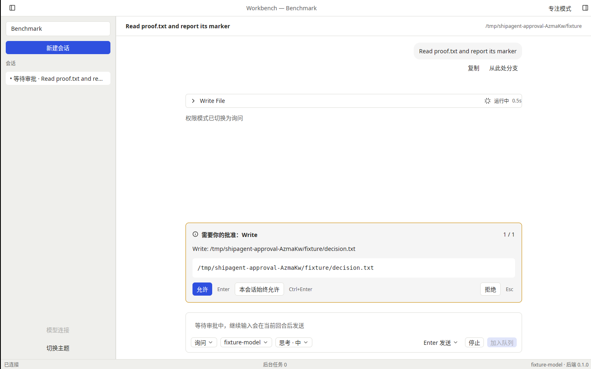
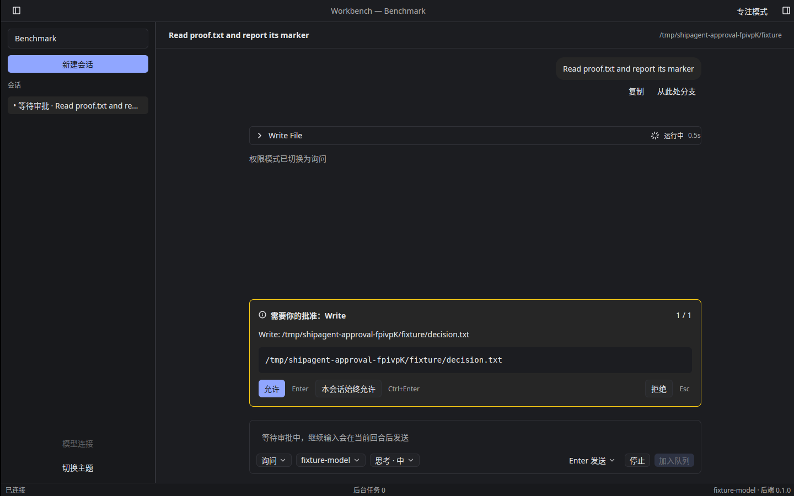
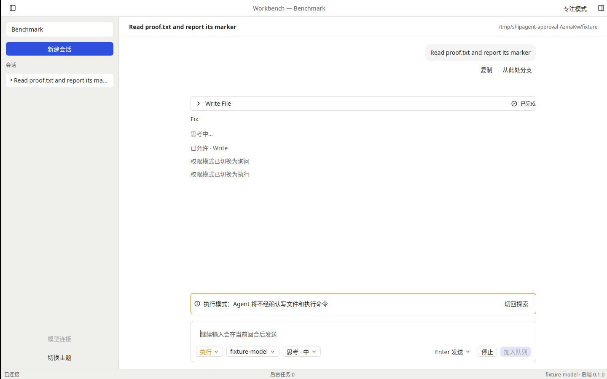

# T-1-15 原生审批与权限模式验证

基线为已合并 PR #21（f0ea93a）。本轮实现 F22/F23 与 PermissionPrompt，不修改固定的 mkagent v0.2.6 后端。下一项为 T-1-16 侧栏与工作区切换。

## 行为与边界

- 原生警告卡位于 Composer 上方，显示工具、描述、等宽命令、后端提供的原因/影响和队列位置。首次待审批时获取焦点，Enter 允许、平台 secondary-Enter 本会话始终允许、Esc 拒绝；仅 `canAlways` 为真时提供始终允许。设置页或模态层不会被隐藏审批抢焦点。
- 每次响应绑定会话、队首 request 与操作代际。提交期间禁用重复响应；失败留在所属请求上并允许重试；切换会话、旧响应、重放或仅聚焦均不会误批准。
- 成功响应在所属用户回合/Assistant 分段留下紧凑回执。使用线性构建的行索引定位，避免流式 delta 扫描整个历史或跨段重复。回执与模式提示是客户端进程内注记，后端消息和持久化记录不变；每类最多保留 128 条。
- 输入框 Shift+Tab 按探索→询问→执行循环，组字及配置提交中不触发。立即调用后端保存模式，草稿保留；重复模式 callback 合并为一条提示。执行模式持续显示警告和“切回探索”。
- 非当前会话等待审批时显示黄色标记，并按本地 `approval_notifications` 偏好发送通用系统提醒。按会话/request 有界去重；提醒不含命令、路径或工具载荷。通知服务拒绝或不可用时恢复显示错误，不阻断审批。完整通知设置、点击导航和其他类型提醒归 T-2-15。

## 已执行的验证

本地 Linux：默认 workspace 274 项通过；完整原生 app/UI/perf/samples 91 项通过，随后新增模式 callback 去重回归，最终 permissions 专项 12 项通过。两种 clippy（默认和 all-features/all-targets）、fmt、152 个引用翻译键检查与 JS 语法检查通过。最终三平台结果以 PR 对应提交的 Actions 为准。

真实固定后端集成测试通过：允许产生文件、拒绝无文件但继续完成、始终允许首次批准后第二回合零审批且实际写入。使用隔离本地脚本模型，实际工具执行由后端完成。三平台 contract 工作流新增同一测试，既有 14 类录制/回放不变。

Linux X11/Vulkan 原生窗口冒烟通过：亮色 Enter 允许并切换执行模式，暗色 Esc 拒绝；均经真实 permission_request 和普通控制器继续至最终提交帧。允许写入、拒绝不写入，退出码 0，未强制清理，所属子进程残留 0。实际窗口截图如下：

原始性能探针把任意 tool error 标成 `outcome: failed`，因此拒绝报告保留这一原值。审批冒烟只在匹配明确的用户拒绝工具结果、正常 complete、无 error/typed_error、无写入且最终帧提交时认定拒绝流程通过，不把它当性能验收。初次脚本过早按键已改为等待真实 user_message；初次拒绝结果分类也已修正，失败记录保留在本轮证据中。

Linux 原生通知显式测试经私有 D-Bus 服务接收一次 Notify，校验通用提醒及超时，通过；普通 CI 不展示未经请求的系统通知。macOS 使用 UNUserNotificationCenter 后端并请求授权，Windows 使用 WinRT；实体通知显示、macOS 安装包授权、Windows 应用身份仍需实际桌面验证。

## 未关闭的验收

这些结果不代表阶段 0 通过，不构成参考机性能、实体桌面、签名/公证或发布验收。按用户确认继续保留 PR #6 工程包，Developer ID Secrets 未配置。三平台 CI 构建/契约与物理桌面验收分别记录。
