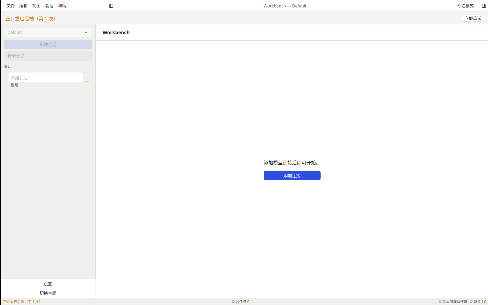
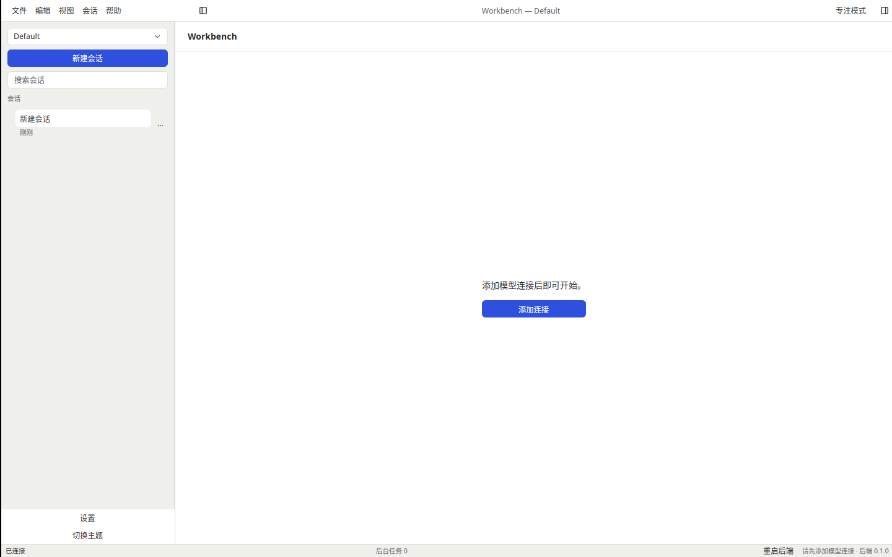

# T-1-21 连接与异常态验证

基线是合并 PR #27 的 59f4958，依据 04 连接/加载/致命/空态与 01 F-02、U6。下一项 T-1-22 macOS nightly 打包签名公证流水线。

## 实现

界面生命周期独立于传输句柄：启动骨架、重连次数/秒倒计时、后端重启、恢复刷新、刷新失败及致命阻断页。断线时保留可读历史与草稿，连接依赖操作保持禁用，直到恢复事务提交。立即重试只唤醒当前退避，不更换端点、不丢重放游标，也不重放写请求。主动重启在运行中的会话或后台任务存在时要求确认。

新连接按连接代际刷新工作区/连接/设置/技能/未读、会话列表与当前会话；迟到结果不得覆盖新连接。有效 resume 保留流式暂态和后台审批；需要重新加载时重读快照并重建缓存，草稿始终保留。刷新期间按上限缓冲事件，失败/中断/下一次刷新接管时先应用已消费事件，溢出保持操作禁用并要求权威重读，避免把丢失事件当作成功。完整 text_complete 已在快照时过滤此前增量，列表不重复追加。

真实契约发现上游退出会发送 server:shuttingDown：原实现永久结束传输线程，监督器的新端点无法接管。现在该通知停止自动重连，但保留等待显式端点替换的通道；显式关闭仍终止传输。新增回归先失败再通过，保留原有“通知后不自动重连”断言。

致命页提供原因、重试、打开实际日志目录、导出恢复元数据；AlreadyRunning 明确提示数据目录被占用。macOS 打开与启动配置相同的 ~/Library/Logs/<bundle_id>。诊断 JSON 仅包含应用/后端版本、平台、架构、状态类别及恢复代际，不包含原始错误、路径、会话、密钥或日志。完整日志 ZIP 仍归 T-2-17。

会话加载超过150ms才显示 Skeleton；快速完成取消迟到骨架。加载错误在消息区提供对同一会话的重试，不隐式重复新建。空会话显示应用名和三个仅填入草稿的提示；当前会话离线删除后可显式新建。无模型连接继续使用已有“添加连接”空态。

## 验证与边界

Linux 默认核心277项、原生153项通过。隔离子进程中的真实原生控制器契约验证：刷新中断缓冲、快速重连接管旧缓冲、后台审批保留、真实后端替换、当前会话及草稿保留、权威名称恢复、列表去重。fmt、329个国际化引用键、全工作区/全目标/全特性 clippy 和普通 workbench 构建通过。三平台 native-check 已加入真实恢复契约；最终提交的 Linux/macOS/Windows CI 结果见本 PR。

Linux 普通应用 Xvfb/Vulkan 实窗使用全新配置，向该配置 .server.lock 中的所属后端 PID 发送 SIGKILL，验证监督器替换后端、当前会话不变、恢复后新建命令重新可用。截图人工核对了重启中的黄色状态/禁用操作以及恢复后的可用状态。原生退出码0、没有强制清理或所属子进程残留。运行方法见 [恢复验证说明](../tools/recovery/README.md)。

独立 Spec/Standards 审查发现的缓冲丢失、后台审批丢失、状态一致性、日志路径和启动骨架问题已修复，并有对应回归。三平台自动化不能替代实体桌面、输入法和参考机性能验收。阶段0、正式签名/公证与发布门槛保持开放；按用户决定保留 PR #6 工程包，不再次索取 Developer ID 凭据。

