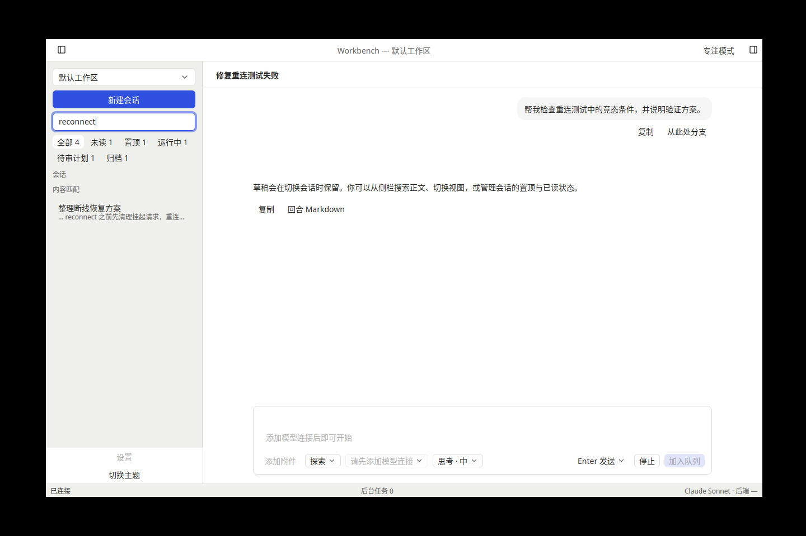
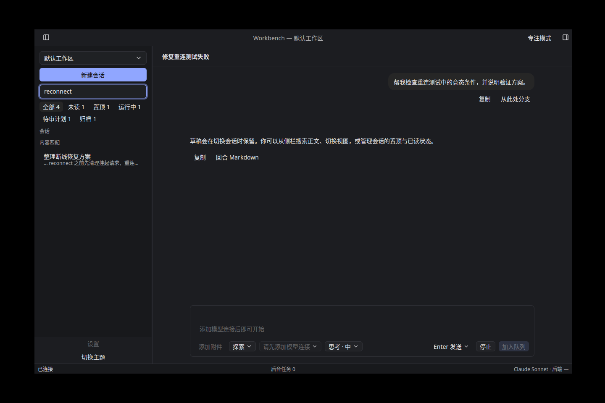

# T-2-09 视图、搜索与会话状态验证

基线为已合并 PR #39（`75e4652`）。依据 01·F-10/11/12、04·侧栏规格；后端继续固定 v0.2.6，协议和模型夹具未改。

## 行为

六个原生视图采用同一套纯核心成员规则与计数：排除 hidden，全部/未读/置顶/运行中/待审计划排除归档；归档单独显示。计数不受搜索词影响，0 不显示。始终按 lastMessageAt 降序，不将置顶另行分组。

右键与更多菜单提供置顶/取消、已读/未读、归档/取消；发送显式目标状态的 typed command。后端广播与权威摘要更新显示，不在 ACK 上盲写状态。未读聚合广播触发摘要刷新；读取期间的新失效会保留并追加一次读取，防止旧快照或旧“已读”回执覆盖新状态。后台会话操作不切换当前对话或清理草稿。

标题立即本地过滤；停顿 300 ms 后请求 sessions:searchContent。正文片段有独立分组，标题同时命中时合并片段及定位动作；键盘和鼠标都可打开并定位到可见 Turn。跳过隐藏、intermediate 和不可定位消息；片段受后端上限限制时保留返回的会话入口并提示片段未提供。Esc 清空，错误可重试；输入、工作区、断线重连和请求代际防止旧结果回写。

固定后端列表摘要没有完整的待审计划标志。客户端在后台按最后可见 user/plan 边界建立索引，最多同时读取两个历史，并按摘要活动版本缓存；接受/调度/失败清理使本地缓存失效。候选计划每 10 秒只重查轻量 pending-plan 状态，选择“待审计划”也立即重查，以覆盖后端不广播的 prepare/clear。加载/失败状态可见；旧回包不能清除读取期间新增的失效。

## 证据

- 默认核心/RPC/工具测试 302 通过；新增纯核心三项、精确 API 参数契约通过；原生侧栏 16 项、工作台 18 项通过。
- 全部原生 UI 分批回归、应用/perf 55 项、客户端能力回归通过。覆盖六视图、计数与排序、冷计划边界、菜单操作、正文/标题合并、无片段结果、隐藏命中跳过、可访问名称、工作区/连接/旧查询隔离及刷新失效归属。
- navigation_contract_parent 使用未修改的本地模型夹具和真实工程后端，在独立原生客户端中验证：冷计划索引、菜单命令、另一个客户端接收 flag 广播及反向状态同步、未读广播刷新、归档恢复、300 ms 正文搜索/消息定位、相同摘要下 prepare→隐藏 / clear→重新出现、拥有的后端重启和新进程状态恢复。
- 真实草稿、后端恢复和计划调度契约回归通过。索引启动时序、隐藏定位和旧回包吞掉新失效的问题均有回归；最后一项先复现失败再修复通过。
- fmt、全工作区所有 target/feature 的 clippy、i18n 和 codegen 防漂移检查通过。规格/工程规范双轴审查的发现已修复。三平台 CI、覆盖率门禁与原生 E2E 的最终结果见本轮 PR 检查，自动化不替代实体桌面验收。

下图为 Linux 原生显示夹具，使用真实主题与控件，提供显式搜索结果用于展示；不作为真实后端证据：

## 保留范围

两并发只约束在途历史读取；后端 getSession 会缓存已加载历史，不能据此宣称大规模历史的总内存或首次索引延迟达标。参考硬件性能及后续历史分页/索引优化仍待验证。后端搜索自身的匹配/片段数量上限仍适用。

本轮验证独立客户端的广播同步；完整多窗口应用仍归 T-2-16，新窗口/导入导出按后续任务推进。F-26 图片上传 Sharp 错误与容量、阶段0/P0、任意强杀耐久性、实体 IME/辅助功能和正式 Developer ID/公证门槛继续开放。下一项 T-2-10 会话分支、导入导出。
