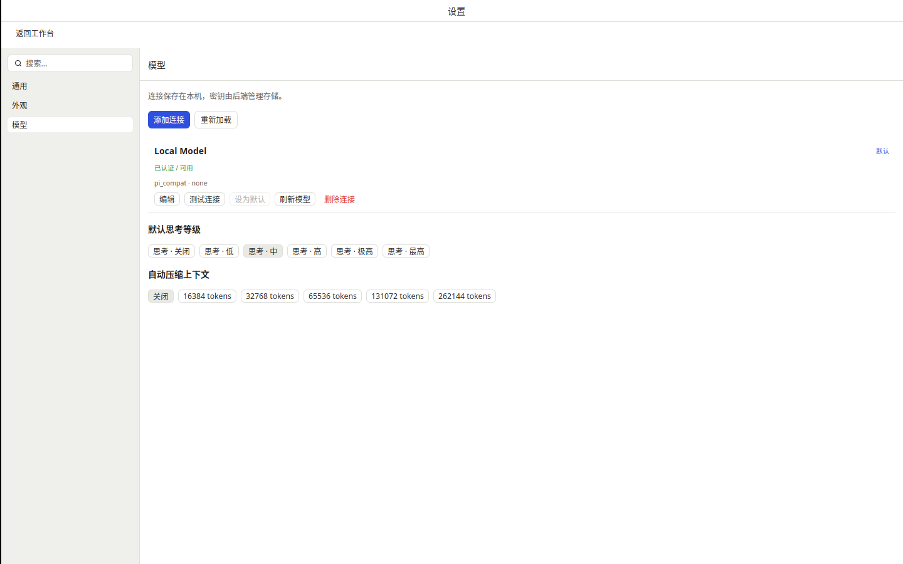
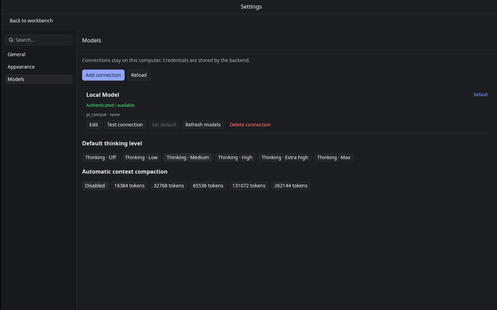
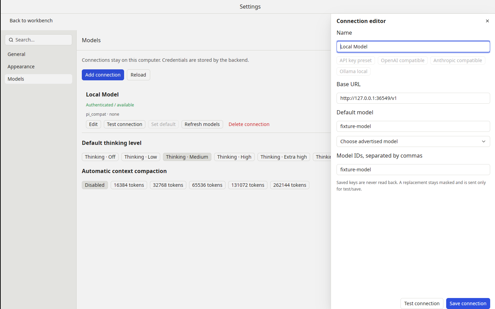

# T-1-17 原生设置验证（2026-11-04）

基于已合并 PR #23（585b770），实现 Kit Settings 替换工作区的通用、外观、模型页面，Ctrl/Cmd+, 打开，返回后保留草稿和先前焦点。普通偏好立即保存；连接表单按视觉稿显式测试/保存。下一项 T-1-18 首次引导。

## 实现范围

- 通用：中英文热切换、恢复上次会话、发送键。外观：跟随系统及已随包提供的 Workbench Light/Dark，12–16 字号，流式文字淡入开关。使用现有 Theme，不引入新的 Global。
- 模型：安全连接目录、预设供应商及模型列表、OpenAI/Anthropic 兼容端点、Ollama，添加/编辑/确认删除、默认连接、刷新、默认思考与自动压缩阈值。编辑保留模型对象扩展元数据和端点协议，阻止旧供应商异步结果覆盖新表单。
- 密钥由后端存储；客户端从不获取已保存明文。替换输入使用 masked Input，关闭/保存后清空。现有 OAuth 只编辑非敏感元数据并检查已保存认证；获取 OAuth 及订阅端到端探测归 T-2-03/04。
- 非 OAuth 的测试实际执行后端 testSetup 模型请求，不能把只检查凭据的 LLM_Connection:test 当模型可用性证明。所有操作使用代际守卫及串行化；编辑 Sheet 的关闭只释放其自身状态。

## 本地验证

完整原生 app/UI/samples 测试 114 项通过（应用 27，UI 单元 8，集成 79；另 1 项子进程夹具按原规则 ignored）。设置专项 7 项覆盖编辑、密钥替换/切换清空、无密钥 Anthropic 协议、过期供应商响应、忙态和偏好事件。默认核心 275 项、格式、i18n 242 引用键、默认及原生全 workspace/all-targets/all-features clippy 通过；三平台最终结果见 PR 检查及随附证据。

Linux Xvfb/Vulkan 软件驱动的普通 workbench 窗口通过 tools/settings/smoke.mjs 操作。脚本使用全新隔离配置、本地模型及真实后端，不启用 perf 绕过；偏好以 JSON 落盘为断言，连接重命名以实际后端 config.json 为断言，退出核对监督器进程树。亮暗截图与报告作为独立证据保留。这不构成实体显示器、IME 候选框或性能门槛验收。

本地完整 settings 后端契约的 testSetup 被云环境只读用户目录阻断：固定上游 SDK 在 homedir()/sessions 创建临时会话时得到 EROFS，尚未发出模型请求。没有修改 HOME、后端源码或忽略该断言；同一真实契约已加入 Linux/macOS/Windows contract CI，在可写用户目录执行。最终三平台结果以本 PR 的最终提交检查为准。

## 验收边界

三平台编译、控件测试、真实后端契约及已有原生窗口提交检查与实体桌面验收分别记录。其他设置归 T-2-02，首次引导归 T-1-18。阶段 0 参考机性能、实体桌面、Developer ID 签名/公证及正式发布仍未验收；按用户决定保留 PR #6 工程包，不要求本轮提供 Secrets。
