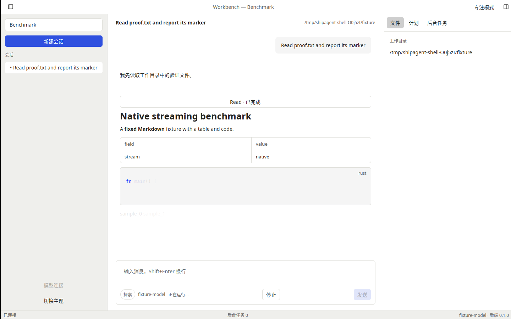
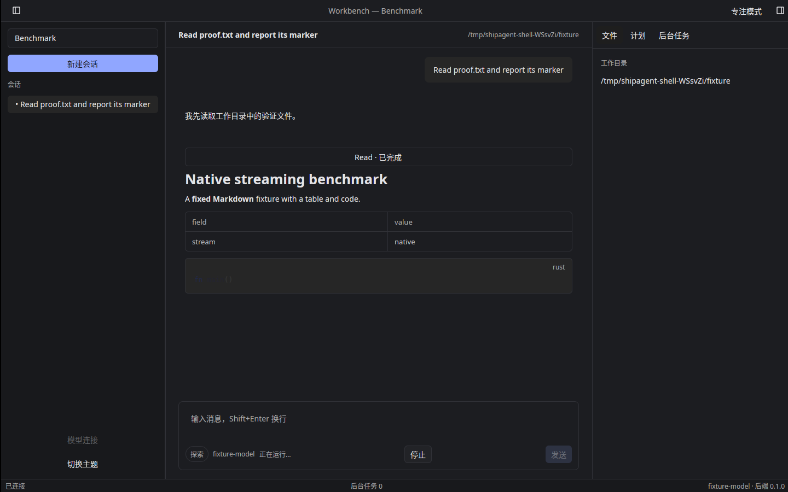

# T-1-10 原生应用骨架验证（2026-11-03）

基线 main `f814cd7`（PR #16 已合并），固定后端仍为 mkagent v0.2.6。本轮实现应用启动骨架、固定三栏、StatusBar、客户端偏好与 F-03 单实例；完整会话侧栏、设置/引导、文件/计划/任务工作流、菜单与用户 keymap 覆盖仍按后续任务推进。

启动在进入 GPUI 事件循环前解析品牌并协商实例、读取小型本地偏好，初始化日志。窗口先显示 Kit Skeleton，再异步启动 sidecar、握手/health 并拉取数据；有连接时恢复所选工作区/会话，缺失会话回退到可用会话。关闭启动恢复会创建空会话；运行中的显式重连仍刷新活动会话，不改变持久化的启动开关。无模型保留现有端点配置入口，未将完整首次引导提前验收。

单实例使用 `interprocess`：Unix 客户端数据目录的 app.sock / Windows 按品牌与规范化配置路径命名的管道。先取得系统文件锁，只有持锁者可以清理旧 socket；普通文件/符号链接不删除，进程退出由系统释放锁。第二次启动仅发送有界 focus 消息、等待确认后退出，不进入 GPUI/sidecar。收发使用非阻塞截止时间，避免依赖 Windows 未支持的 socket timeout API。后台接收器仅接受 focus 并激活已有主窗口，不执行传入 URL。测试包含独立进程转发和过期 socket / 配置隔离。

客户端 prefs.json 与后端凭据目录分开：macOS ~/Library/Application Support/<bundle_id>；Windows %APPDATA%/<bundle_id>；Linux $XDG_CONFIG_HOME/<bundle_id> 或 ~/.config/<bundle_id>。开发可设置 AGENTKIT_APP_DATA_DIR；若仅设置隔离的 AGENTKIT_CONFIG_DIR，客户端默认位于其 client 子目录。性能 runner 显式使用独立 client 目录，保持后端配置起初为空。偏好不存 token/会话内容，包含语言、system/light/dark、窗口几何、栏宽/展开、当前标签/专注、上次工作区/会话与恢复开关。

偏好写入在后台有序合并、同目录原子替换，最新状态不会被旧写入覆盖。格式损坏/未来版本保留原文件并以内存默认值启动，显示只读提示；保存失败通过控制器通知到本地化 Alert，不在前台读写文件或 stderr。退出先开始后端清理，并把偏好完成等待限制为80ms；慢存储不阻挡 GPUI 200ms 退出清理预算。常规退出在退出事件循环前完成有序保存和后端关闭。

布局按04页：默认1280×820、最小960×600，标题40px、状态栏24px；侧栏默认280、240–420可拖拽，低于1100自动收起；右栏默认关闭、360及280–560可拖拽，低于1280使用Kit Sheet。窄屏手动展开侧栏也使用Sheet，支持Esc及焦点返回。自动折叠不覆盖用户偏好；恢复栏宽会重置旧的Resizable内部尺寸，侧栏固定分配保证布局稳定后仍与保存值一致。会话区保留820px最大内容宽度。右侧展示真实目录/已提交计划引用/观测后台工作上下文，未伪造文件列表或实现尚未排期的预览。StatusBar汇总已打开会话的后台任务身份，切换会话不归零。主题与语言由客户端控制，不调用后端 theme 频道。

中央actions/keymap绑定退出、新会话、侧栏、右栏、专注；根视图在启动时取得焦点，就绪后聚焦输入。组件使用语义主题Token及本地化可访问名称。全量菜单、快捷键编辑、完整设置页等仍归各自任务。

本地验证包括：偏好默认/版本/损坏尺寸、原子最新写入、保存失败、窗口标题可见性、独立进程focus、旧socket保留规则、后台任务跨会话去重、启动恢复与重连区别、慢偏好退出、三栏/拖拽/精确恢复宽度、窄屏Sheet/Esc、960×600输入可见性、只读提示和后台状态。原有纯核心与真实Agent契约另回归；最终计数及三平台结果见PR和导出证据。

Linux隔离Xvfb/lavapipe亮暗实窗各完成：相同配置第二次启动确认聚焦、原生Ctrl+Shift+B及偏好保存、真实Read/流式答复/帧呈现、正常退出且无残留拥有子进程。见 [实窗工具](../tools/shell-smoke/README.md)；调试构建不作为参考机性能验收。300ms首帧/1.5秒输入、物理桌面、真实签名/公证、阶段0与发布门槛仍未关闭；PR #6 工程包保留。

亮/暗截图来自隔离验证会话的真实流式窗口：

下一项 T-1-11：i18n 转换管线与 CI 检查。
