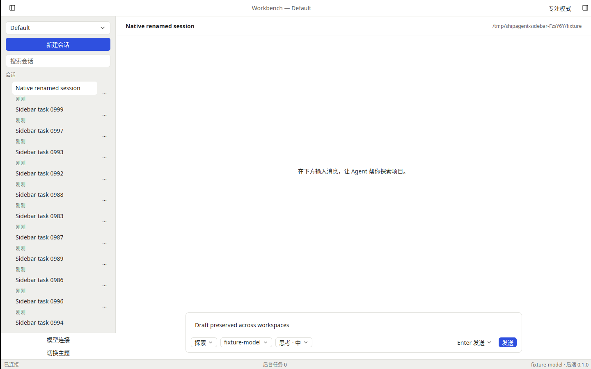
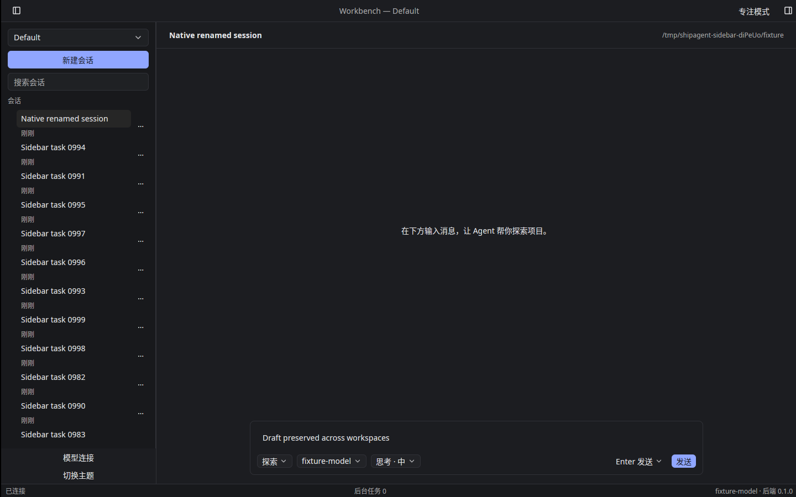
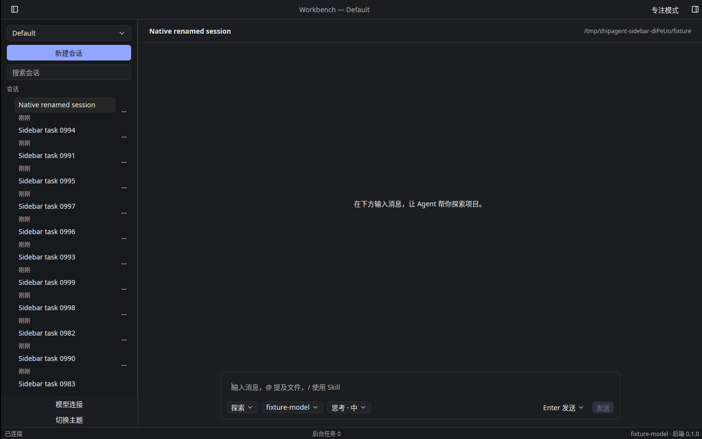

# T-1-16 原生侧栏与工作区切换验证

基线为已合并 PR #22（3a353db）。范围为 04 页、F-07/F-08/F-09：SessionSidebar 列表、新建、重命名、删除及 WorkspaceSwitcher。下一项 T-1-17 模型连接管理、外观与语言设置。

## 实现

- 52 px 固定行高虚拟列表，按 `lastMessageAt` 降序、相同时按 ID 排序；不单独分组置顶；默认排除 hidden/归档。仅实例化可见行，不在每次渲染复制全部会话；流式事件已经处于运行状态时不重复失效列表。
- 标题省略、相对时间/状态说明；待审批、运行、待审计划、未读按优先级显示，已有旗标被动显示。用户消息推进活动时间，complete 使用后端 `hasUnread`，确认 MarkRead 后立即清除本地标记。
- 本地标题搜索、Esc 清空；列表焦点下方向键、Home/End、Enter、F2、Delete/Backspace。点击打开后保留导航焦点；输入框正常处理文字编辑。右键或更多菜单提供重命名与红色删除项；原生删除对话框需再次确认，标题双击也可重命名。
- 工作区菜单列出全部注册工作区，创建表单使用原生名称输入及系统单目录选择器，提交前调用 checkSlug。当前工作区不可移除并提示先切换；其他工作区需二次确认后注销，保留本地目录和会话。
- 后端 switch 同时更新服务器绑定与未来重连握手；加载目标设置、Skills、列表及上次所选会话后更新窗口。失败尝试恢复旧绑定，恢复失败进入明确重载状态。首个会话使用工作区默认目录；偏好记住当前工作区/会话。
- 往返切换保留草稿、已打开 SessionStore 的 Entity 身份、待审批队列和客户端审批 lease/error/回执/模式注记。私有提交状态尚未获得 RPC ack 时暂不切换，即使 canonical echo 已先到。
- 加载期间缓冲事件向新列表和当前会话回放；删除事件防止已删目标复活。列表刷新使用独立代际租约，切换中不启动刷新，旧 completion 不会误解锁新刷新。

正文搜索、视图筛选、置顶/归档/已读命令属于 T-2-09，导入导出与多窗口属于 T-2-10/16。完整键盘定制与无障碍走查继续按后续任务推进。

## 验证

本地 Linux 默认 workspace 275 项、原生 app/UI/perf/samples 104 项、fmt、默认及 all-features/all-targets clippy、183 个翻译键检查通过；最终三平台逐项数量见本 PR 对应提交的 CI。专项覆盖千条虚拟列表、排序/状态更新、断连后控件更新、本地搜索清空、菜单动作焦点、重命名重复提交/失败重试、目录选择与取消、表单可访问名称，以及工作区返回时的审批状态和代际竞态。

新增真实固定后端契约：创建/重命名/删除会话、工作区列表隔离、拒绝移除当前工作区、移除保留目录、重新注册保留 ID 及会话内容。已在 Linux 执行通过，同一测试加入三平台 contract；既有 14 类录制回放不变。

Linux X11/Vulkan 亮暗实际窗口：通过普通 API 在隔离临时配置下创建 1,000 个会话和第二个空工作区，使用实际鼠标/键盘重命名（核对真实 name_changed）、取消删除、输入草稿、切换空工作区、新建另一会话、返回原选中会话。两种主题均通过，返回后草稿可见；退出码 0、未强制清理、所属子进程残留 0。复现命令见 [导航工具](../tools/sidebar/README.md)。

初次冒烟暴露并修正了打开会话后焦点转移、表单焦点被对话框覆盖、菜单动作上下文和子 Entity 就绪通知问题，均补回归。脚本另修正同时间戳会话的排序预期及按键/渲染时序，重命名仅以明确后端事件作为成功依据；早期失败记录保留在本轮证据中。

独立 Spec 与 Standards 审查最终无阻塞。原生虚拟化和操作验证不等于参考机 60 fps 或物理桌面验收，不推导 200 ms 跨平台端到端性能结论。阶段 0、实体桌面、签名/公证、发布门槛仍未关闭；按用户确认继续保留 PR #6 工程包，暂无 Developer ID Secrets。
