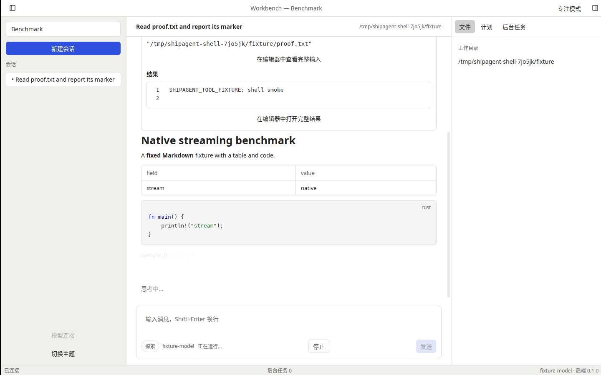
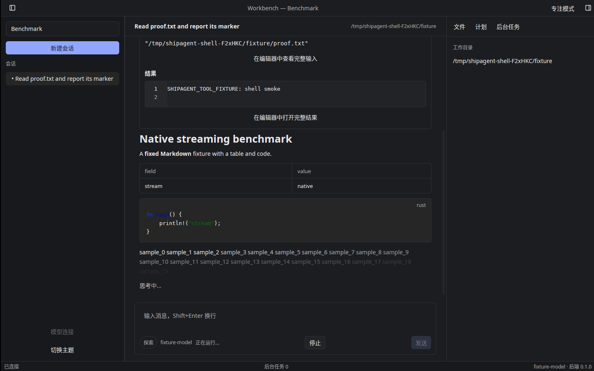

# T-1-13 原生工具卡验证（2026-11-03）

基线 main `3607cd7`（PR #19 已合并），后端仍固定 mkagent v0.2.6。本轮实现 F16 的 ToolCard、Diff、只读 Editor、大输出与嵌套呈现，不修改后端、协议或纯核心状态。后台任务轮询/停止归 T-2-11，自定义渲染器注册归 T-4-02；下一项 T-1-14 Composer。

工具卡默认仅显示摘要，包含名称、状态、错误、可用耗时及意图；展开才创建正文 Entity。状态使用规范 Activity 状态，成功 Read 的文件正文即使包含拒绝提示也不改变状态。折叠释放正文；原始活动 ID 保持稳定。后续回合更新时仅比较有界预览，保留内容未变的编辑器 Entity、焦点和选区，不复制完整历史工具结果。

Read/代码及通用结果使用 Kit 原生只读 Editor；Edit/Write 支持 Pi、Claude 和 Codex 的变更输入与 unified diff，后台准备差异后创建 Kit DiffState。输入推导出的差异明确标注“变更内容预览”，真实执行结果独立展示，不把输入当作已写入的完整文件。损坏的 patch 回退为只读文本；仅真正截断的 patch 才允许截断 hunk。原始错误结果仍可查看。

预览限制为2000行、256KiB，UTF-8安全截取；输入摘要最多40字段、每字段320字节，Codex多文件变更最多64项。旧/新文本的合计预览也受同一上限约束。界面明确提示限制，并提供完整结果、完整输入及长字段的只读编辑器入口。完整内容按会话及 Activity ID 从规范模型解析，序列化在后台执行，打开时检查会话 epoch；不执行工具、不写文件、不拥有 RPC 或凭据。100000行完整结果不受预览截取影响，编辑器采用原生虚拟行呈现。

嵌套展示使用既有上游兼容分组函数；TaskOutput用量、续组和孤立子项保留，循环引用回退到可见活动，缩进最多4级。独立展开子组，不更改规范父子关系。

本地默认核心273项通过；原生 app/UI/perf/samples共71项通过，其中本轮纯工具策略6项、原生工具测试9项。覆盖只读输入拒绝、折叠惰性创建/释放、原生Diff统计、损坏patch、100000行、长JSON字段完整内容意图、嵌套/循环/续组、结果更新及历史编辑器在后续回合追加时保留焦点。fmt、clippy、all-targets/all-features检查和122键国际化门禁通过。规格与工程规范独立审查均无剩余阻塞。最终提交的三平台CI、契约和录制/回放结果以PR检查和导出证据为准。

Linux X11/Xvfb/lavapipe亮暗实窗各完成真实Read工具展开、50模拟token/s流式答复及最终出帧；二次启动聚焦、快捷键/偏好恢复、正常退出和零拥有子进程通过。截图使用明确的本地基准夹具。首次暗色启动曾在窗口创建前退出；保留失败报告，随后使用禁用自动重置的隔离X11服务重新运行亮暗两次均通过，不据此宣称已定位产品问题或完成物理桌面验收。

这些调试功能测试不代表参考机帧预算、完整性能、Wayland实机或物理桌面验收。阶段0、真实性能、真实签名/公证和发布门槛仍开放，PR #6 工程包保留。
